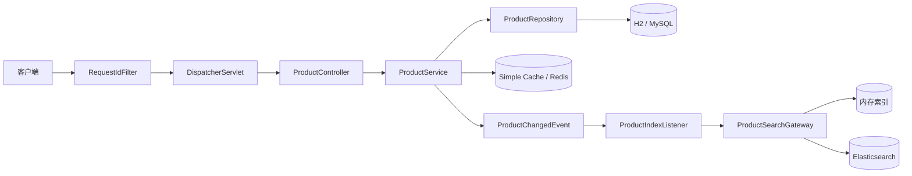
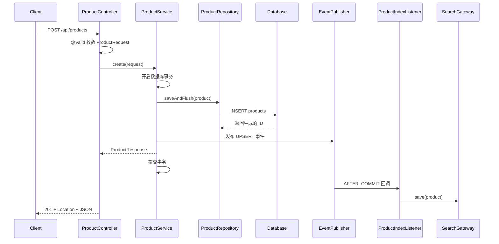
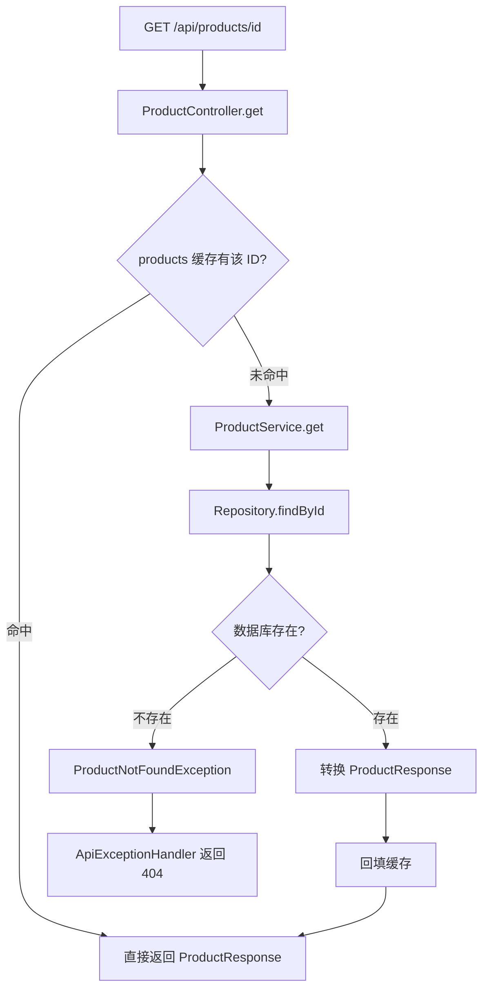
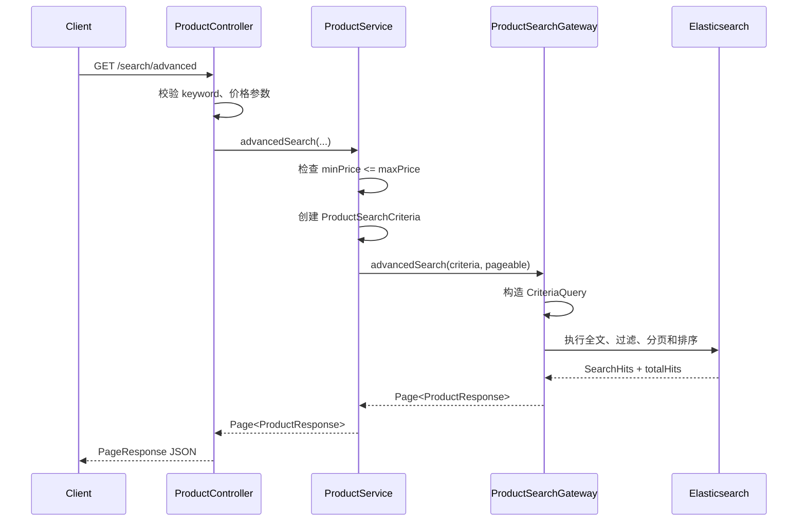
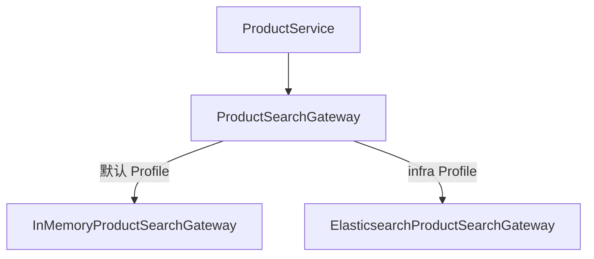

# Spring Boot 商品接口完整链路讲解

本文基于 `java_exp` 项目的当前源码，讲解以下四个接口：

1. `POST /api/products`：创建商品
2. `GET /api/products/{productId}`：查询单个商品
3. `GET /api/products/page`：分页查询商品
4. `GET /api/products/search/advanced`：使用 Elasticsearch 进行复杂关键字查询

文档重点不是只介绍 Controller 的写法，而是说明请求从进入 Spring Boot 到返回 JSON 的完整过程，以及 JPA、事务、缓存、事件和 Elasticsearch 分别在什么时候参与。

---

## 1. 接口总览

| 场景 | HTTP 接口 | 主要数据源 | 缓存 | 主要返回状态 |
|---|---|---|---|---|
| 创建商品 | `POST /api/products` | JPA / 数据库 | `@CachePut` 写入详情缓存 | `201 Created` |
| 查询单个商品 | `GET /api/products/{id}` | 缓存，未命中再查 JPA | `@Cacheable` | `200` / `404` |
| 分页查询 | `GET /api/products/page` | JPA / 数据库 | 不缓存 | `200 OK` |
| 复杂搜索 | `GET /api/products/search/advanced` | ES 或内存索引 | 不使用详情缓存 | `200` / `400` |

Controller 的统一路径定义在：

```java
@RequestMapping("/api/products")
```

源码入口：

- `src/main/java/com/example/javaexp/product/api/ProductController.java:29-32`
- `src/main/java/com/example/javaexp/product/service/ProductService.java:22-36`

---

## 2. 整体架构



### 2.1 各层职责

| 层 | 类 | 职责 |
|---|---|---|
| Web 入口 | `ProductController` | 路由、参数接收、参数校验、HTTP 状态码 |
| 业务层 | `ProductService` | 事务、缓存、业务规则、DTO 转换、事件发布 |
| 数据访问层 | `ProductRepository` | 使用 Spring Data JPA 操作数据库 |
| 数据模型 | `Product` | JPA Entity，对应 `products` 表 |
| 搜索抽象 | `ProductSearchGateway` | 隔离搜索实现，Service 不直接依赖 ES |
| ES 实现 | `ElasticsearchProductSearchGateway` | 构造 ES 查询、保存和删除索引文档 |
| 默认实现 | `InMemoryProductSearchGateway` | 不启用 `infra` 时使用内存模拟搜索 |
| 索引监听 | `ProductIndexListener` | 数据库事务提交后更新搜索索引 |
| 异常转换 | `ApiExceptionHandler` | 将业务异常和校验异常转换成 JSON 响应 |

### 2.2 Bean 为什么会在特定时机执行

这些类成为 Bean 后，并不是所有方法都会自行执行，而是由不同扩展机制在特定时机回调：

| Bean | 被调用的原因 |
|---|---|
| `RequestIdFilter` | 继承 `OncePerRequestFilter`，HTTP 请求经过过滤器链时执行 |
| `ProductController` | URL 和 `@GetMapping`、`@PostMapping` 匹配时执行 |
| `ProductService` | 被 Controller 显式调用 |
| `ProductIndexListener` | 发布 `ProductChangedEvent` 且事务提交成功后执行 |
| `ElasticsearchProductSearchGateway.createIndex()` | 标记了 `@PostConstruct`，Bean 初始化后执行一次 |

因此可以记住：

> Bean 表示对象由 Spring 管理；接口、父类和注解决定框架何时回调它。

---

## 3. 所有请求共有的入口链路

四个接口都会先经过 `RequestIdFilter`：

```text
HTTP 请求
  -> RequestIdFilter
  -> DispatcherServlet
  -> 参数解析与校验
  -> ProductController
  -> ProductService
  -> Repository / Cache / SearchGateway
  -> JSON 响应
```

`RequestIdFilter` 会：

1. 读取请求头 `X-Request-Id`。
2. 请求头不存在、不合法或超过 100 个字符时生成 UUID。
3. 把 Request ID 写入响应头。
4. 把 Request ID 放入 SLF4J MDC，供当前请求的日志使用。
5. 在 `finally` 中清除 MDC，避免线程池复用造成串号。

源码：`src/main/java/com/example/javaexp/config/RequestIdFilter.java:17-40`

---

## 4. DTO、Entity 与 ES Document

项目没有直接使用 `Product` Entity 作为接口请求和响应对象，而是分成三类模型。

### 4.1 ProductRequest

用于创建和更新商品：

```java
public record ProductRequest(
        @NotBlank @Size(max = 100) String name,
        @NotBlank @Size(max = 50) String category,
        @NotNull @DecimalMin(value = "0.01") BigDecimal price,
        @NotBlank @Size(max = 1000) String description) {
}
```

校验规则：

| 字段 | 规则 |
|---|---|
| `name` | 非空，最长 100 |
| `category` | 非空，最长 50 |
| `price` | 非空，最低 `0.01` |
| `description` | 非空，最长 1000 |

源码：`src/main/java/com/example/javaexp/product/api/ProductRequest.java:10-15`

### 4.2 Product

`Product` 是 JPA Entity，对应数据库的 `products` 表。

`@PrePersist` 会在第一次持久化前设置：

```text
createdAt = 当前时间
updatedAt = 当前时间
```

`@PreUpdate` 会在更新 SQL 执行前刷新 `updatedAt`。

源码：`src/main/java/com/example/javaexp/product/model/Product.java`

### 4.3 ProductResponse

接口统一返回 `ProductResponse`，避免把数据库 Entity 直接暴露给客户端。

转换入口：

```java
ProductResponse.from(product)
```

### 4.4 ProductDocument

ES 使用独立的 `ProductDocument`：

| 字段 | ES 类型 | 用途 |
|---|---|---|
| `id` | ID | 文档唯一标识 |
| `name` | `Text` | 分词和关键字匹配 |
| `category` | `Keyword` | 精确过滤 |
| `price` | `Scaled_Float` | 金额范围查询 |
| `description` | `Text` | 分词和关键字匹配 |
| 时间字段 | `Date` | 返回和排序扩展 |

源码：`src/main/java/com/example/javaexp/product/search/ProductDocument.java:13-21`

---

# 5. 创建商品

## 5.1 接口定义

```http
POST /api/products
Content-Type: application/json
```

请求示例：

```json
{
  "name": "Hotpot Set",
  "category": "Group Meal",
  "price": 128.00,
  "description": "A hotpot meal for two people"
}
```

调用示例：

```bash
curl -i -X POST 'http://localhost:8082/api/products' \
  -H 'Content-Type: application/json' \
  -H 'X-Request-Id: create-product-001' \
  -d '{
    "name": "Hotpot Set",
    "category": "Group Meal",
    "price": 128.00,
    "description": "A hotpot meal for two people"
  }'
```

成功响应：

```http
HTTP/1.1 201 Created
Location: /api/products/1
X-Request-Id: create-product-001
```

```json
{
  "id": 1,
  "name": "Hotpot Set",
  "category": "Group Meal",
  "price": 128.00,
  "description": "A hotpot meal for two people",
  "createdAt": "2026-10-25T17:00:00",
  "updatedAt": "2026-10-25T17:00:00"
}
```

## 5.2 执行时序



## 5.3 Controller 做了什么

源码：`ProductController.java:40-46`

```java
@PostMapping
public ResponseEntity<ProductResponse> create(
        @Valid @RequestBody ProductRequest request) {
    ProductResponse product = productService.create(request);
    return ResponseEntity
            .created(URI.create("/api/products/" + product.id()))
            .body(product);
}
```

关键点：

1. `@RequestBody` 让 Jackson 把 JSON 转换成 `ProductRequest`。
2. `@Valid` 执行 DTO 上的校验注解。
3. 校验失败时不会进入 Service，而是抛出 `MethodArgumentNotValidException`。
4. 创建成功返回 `201 Created`。
5. `Location` 响应头指向新资源 `/api/products/{id}`。

## 5.4 Service 做了什么

源码：`ProductService.java:38-49`

```java
@CachePut(cacheNames = "products", key = "#result.id()")
@Transactional
public ProductResponse create(ProductRequest request) {
    Product product = new Product(...);
    ProductResponse response =
            ProductResponse.from(productRepository.saveAndFlush(product));
    publishChange(ProductChangedEvent.Type.UPSERT, response);
    return response;
}
```

### `@Transactional`

方法进入时由 Spring 的事务拦截器开启事务：

```text
开始事务
  -> 执行 INSERT
  -> 发布事务事件
  -> 方法正常结束
  -> 提交事务
```

如果持久化过程中出现运行时异常，事务会回滚。

### `saveAndFlush`

`save()` 主要把 Entity 放入 JPA 持久化上下文，SQL 可能延迟到 flush 或事务提交时执行。

这里使用 `saveAndFlush()`，会立即触发 flush，使 INSERT 更早发送到数据库，并获得数据库生成的 ID。随后才能构造包含 ID 的 `ProductResponse`、缓存 Key 和 ES 文档。

### `@CachePut`

`@CachePut` 不会跳过方法执行。它会先创建数据库记录，再把返回值写入：

```text
缓存名称：products
缓存 Key：新商品 ID
缓存 Value：ProductResponse
```

它与查询接口的 `@Cacheable` 使用同一缓存，因此商品创建后第一次按 ID 查询通常可以直接命中缓存。

### 为什么通过事件更新 ES

Service 不直接调用 ES，而是发布：

```java
new ProductChangedEvent(Type.UPSERT, response)
```

`ProductIndexListener` 使用：

```java
@TransactionalEventListener(phase = TransactionPhase.AFTER_COMMIT)
```

只有数据库事务成功提交，监听器才会更新搜索索引。这样可以避免数据库已经回滚、ES 却保留商品文档的明显不一致。

需要注意：这是“事务提交后同步调用 ES”，不是分布式事务。如果数据库提交成功后 ES 写入失败，数据库数据仍然存在，索引可能暂时缺失。生产系统通常会进一步使用 Outbox、消息队列、重试和对账任务。

---

# 6. 查询单个商品

## 6.1 接口定义

```http
GET /api/products/{productId}
```

调用示例：

```bash
curl -i 'http://localhost:8082/api/products/1'
```

成功时返回 `200 OK` 和一个 `ProductResponse`。

商品不存在时返回：

```http
HTTP/1.1 404 Not Found
```

```json
{
  "timestamp": "2026-10-25T09:00:00Z",
  "status": 404,
  "message": "Product 999 was not found",
  "fieldErrors": {}
}
```

## 6.2 缓存命中与未命中



Controller 源码：`ProductController.java:48-51`

Service 源码：`ProductService.java:51-55`

```java
@Cacheable(cacheNames = "products", key = "#productId")
@Transactional(readOnly = true)
public ProductResponse get(Long productId) {
    return ProductResponse.from(findProduct(productId));
}
```

### 缓存命中

Spring Cache 代理先查询：

```text
cacheName = products
key = productId
```

命中后直接返回缓存中的 `ProductResponse`，方法体不会执行，因此不会查询数据库。

### 缓存未命中

未命中时才执行方法体：

```java
productRepository.findById(productId)
```

查询成功后转换成 `ProductResponse`，方法正常返回时 Spring 再把结果写入缓存。

### `readOnly = true`

这表示该事务只用于读取：

```java
@Transactional(readOnly = true)
```

它向事务管理器和 JPA Provider 表达“本方法不准备修改数据”，有助于减少不必要的脏检查，也能明确代码意图。

### 商品不存在

`findProduct()` 使用：

```java
productRepository.findById(productId)
        .orElseThrow(() -> new ProductNotFoundException(productId));
```

异常被 `ApiExceptionHandler` 捕获并转换成 `404`。这样 Service 只表达业务事实“商品不存在”，不直接处理 HTTP 响应。

源码：

- `ProductService.java:124-127`
- `ApiExceptionHandler.java:21-29`

---

# 7. 分页查询商品

## 7.1 接口定义

```http
GET /api/products/page
```

支持参数：

| 参数 | 必填 | 默认值 | 说明 |
|---|---|---|---|
| `category` | 否 | 无 | 按分类过滤，忽略大小写 |
| `page` | 否 | `0` | 页码，从 0 开始 |
| `size` | 否 | `10` | 每页数量，项目最大限制为 100 |
| `sort` | 否 | `updatedAt,desc` | 排序字段和方向 |

无分类分页：

```bash
curl -G 'http://localhost:8082/api/products/page' \
  --data-urlencode 'page=0' \
  --data-urlencode 'size=20' \
  --data-urlencode 'sort=price,desc'
```

按分类分页：

```bash
curl -G 'http://localhost:8082/api/products/page' \
  --data-urlencode 'category=Group Meal' \
  --data-urlencode 'page=0' \
  --data-urlencode 'size=10'
```

响应结构：

```json
{
  "content": [
    {
      "id": 1,
      "name": "Hotpot Set",
      "category": "Group Meal",
      "price": 128.00,
      "description": "A hotpot meal for two people",
      "createdAt": "2026-10-25T17:00:00",
      "updatedAt": "2026-10-25T17:00:00"
    }
  ],
  "page": 0,
  "size": 10,
  "totalElements": 1,
  "totalPages": 1
}
```

## 7.2 Pageable 如何生成

Controller 源码：`ProductController.java:58-64`

```java
@GetMapping("/page")
public PageResponse<ProductResponse> page(
        @RequestParam(required = false) String category,
        @PageableDefault(
                sort = "updatedAt",
                direction = Sort.Direction.DESC)
        Pageable pageable) {
    return PageResponse.from(productService.page(category, pageable));
}
```

客户端不需要手动构造 `Pageable`。Spring MVC 会读取 `page`、`size`、`sort` 参数并创建对象。

例如：

```http
?page=1&size=20&sort=price,desc&sort=name,asc
```

大致转换成：

```text
PageRequest:
  page = 1
  size = 20
  sort = price DESC, name ASC
```

## 7.3 Service 如何选择 Repository 方法

Service 源码：`ProductService.java:65-71`

```java
Page<Product> products =
        category == null || category.isBlank()
                ? productRepository.findAll(pageable)
                : productRepository.findByCategoryIgnoreCase(
                        category, pageable);
```

存在两条分支：

### 不传 category

调用 `JpaRepository` 自带的：

```java
findAll(Pageable pageable)
```

### 传入 category

调用派生查询：

```java
findByCategoryIgnoreCase(String category, Pageable pageable)
```

Spring Data JPA 根据方法名拆解语义：

```text
findBy                查询
Category              Product.category 字段
IgnoreCase            忽略大小写
(..., Pageable)       增加分页和排序
```

源码：`ProductRepository.java:18`

## 7.4 分页 SQL 的基本形态

JPA 会根据数据库方言生成类似的查询。以下是帮助理解的示意 SQL，不保证与 Hibernate 最终 SQL 字符完全相同：

```sql
SELECT *
FROM products
WHERE LOWER(category) = LOWER(?)
ORDER BY updated_at DESC
LIMIT ? OFFSET ?;
```

分页通常还需要统计总数：

```sql
SELECT COUNT(*)
FROM products
WHERE LOWER(category) = LOWER(?);
```

内容查询用于获得当前页，Count 查询用于计算：

```text
totalElements
totalPages
```

## 7.5 Entity Page 如何转换

Service 使用：

```java
products.map(ProductResponse::from)
```

`Page.map()` 会保留分页元数据，只转换 `content` 中的元素：

```text
Page<Product>
  -> Page<ProductResponse>
  -> PageResponse<ProductResponse>
```

最终通过 `PageResponse.from()` 输出稳定的接口结构。

源码：`PageResponse.java:7-21`

## 7.6 为什么分页列表暂不缓存

列表缓存的 Key 会受到多个参数影响：

```text
category + page + size + sort
```

任何商品创建、更新或删除，都可能让多个列表缓存同时失效。当前项目只缓存按 ID 查询，避免维护大量列表 Key 和复杂的失效策略。

---

# 8. Elasticsearch 复杂关键字查询

## 8.1 接口定义

```http
GET /api/products/search/advanced
```

支持参数：

| 参数 | 必填 | 校验/默认值 | 含义 |
|---|---|---|---|
| `keyword` | 是 | 非空，最长 100 | 匹配名称或描述 |
| `category` | 否 | 最长 50 | 分类精确过滤 |
| `minPrice` | 否 | 大于等于 0 | 最低价格 |
| `maxPrice` | 否 | 大于等于 0 | 最高价格 |
| `page` | 否 | `0` | 页码，从 0 开始 |
| `size` | 否 | `20` | 每页数量 |
| `sort` | 否 | 无 | ES 排序字段和方向 |

调用示例：

```bash
curl -G 'http://localhost:8082/api/products/search/advanced' \
  --data-urlencode 'keyword=Discovery' \
  --data-urlencode 'category=Group Meal' \
  --data-urlencode 'minPrice=100.00' \
  --data-urlencode 'maxPrice=200.00' \
  --data-urlencode 'page=0' \
  --data-urlencode 'size=10' \
  --data-urlencode 'sort=price,desc'
```

Controller 源码：`ProductController.java:75-98`

## 8.2 调用链



## 8.3 Service 的业务校验

Controller 上的 `@DecimalMin("0.00")` 只能保证价格不为负数，不能表达两个参数之间的关系。

因此 Service 额外校验：

```java
if (minPrice != null
        && maxPrice != null
        && minPrice.compareTo(maxPrice) > 0) {
    throw new InvalidSearchCriteriaException(
            "minPrice must be less than or equal to maxPrice");
}
```

这类规则属于跨字段业务规则，放在 Service 比单字段校验注解更清晰。

异常最终由 `ApiExceptionHandler` 转换成 `400 Bad Request`。

源码：

- `ProductService.java:84-100`
- `ApiExceptionHandler.java:31-40`

## 8.4 为什么使用 ProductSearchGateway

`ProductService` 注入的是接口：

```java
private final ProductSearchGateway productSearchGateway;
```

而不是直接注入：

```java
ElasticsearchOperations
```

这样业务层只知道“需要搜索商品”，不需要知道搜索由 ES 还是内存完成。



Profile 选择：

```java
@Profile("!infra")  // 默认内存实现
@Profile("infra")   // Elasticsearch 实现
```

默认启动时，复杂查询仍能运行，但查询的是 `ConcurrentHashMap` 模拟索引，不是真正的 Elasticsearch。

只有激活 `infra` Profile，才会使用 ES：

```bash
mvn spring-boot:run -Dspring-boot.run.profiles=infra
```

## 8.5 ES 查询如何构造

源码：`ElasticsearchProductSearchGateway.java:61-88`

第一步，构造关键字查询：

```java
Criteria queryCriteria =
        new Criteria("name").matches(criteria.keyword())
                .or(new Criteria("description")
                        .matches(criteria.keyword()));
```

表示关键字可以匹配：

```text
name OR description
```

第二步，按需添加过滤条件：

```java
category = 指定分类
price >= minPrice
price <= maxPrice
```

整体逻辑可以理解为：

```text
(name MATCH keyword OR description MATCH keyword)
AND category = category
AND price >= minPrice
AND price <= maxPrice
```

未传入的可选条件不会加入查询。

第三步，设置分页和排序：

```java
CriteriaQuery query = new CriteriaQuery(queryCriteria);
query.setPageable(pageable);
```

第四步，执行查询：

```java
SearchHits<ProductDocument> hits =
        operations.search(query, ProductDocument.class);
```

第五步，转换响应：

```text
SearchHit<ProductDocument>
  -> ProductDocument
  -> ProductResponse
  -> PageImpl<ProductResponse>
  -> PageResponse<ProductResponse>
```

`hits.getTotalHits()` 用于填写总记录数。

## 8.6 `Text` 与 `Keyword` 的区别

`name` 和 `description` 使用 `FieldType.Text`：

```java
@Field(type = FieldType.Text)
```

Text 字段会经过分析器处理，适合全文检索。`matches(keyword)` 通常对应 Match 类查询，而不是数据库中的简单 `LIKE '%keyword%'`。

`category` 使用 `FieldType.Keyword`：

```java
@Field(type = FieldType.Keyword)
```

Keyword 通常不分词，适合精确过滤、聚合和排序。当前代码使用：

```java
new Criteria("category").is(criteria.category())
```

因此 ES 模式下分类值通常需要与索引中的 Keyword 值精确一致。默认内存实现使用 `equalsIgnoreCase`，两种实现的大小写语义并不完全相同。

`price` 使用：

```java
@Field(
    type = FieldType.Scaled_Float,
    scalingFactor = 100)
```

金额按 100 倍缩放后保存，适合两位小数的价格范围查询。

## 8.7 商品如何进入 ES 索引

复杂搜索不会直接查询数据库，因此商品必须先进入 ES 索引。

写入链路：

```text
创建或更新商品
  -> 数据库事务内发布 UPSERT 事件
  -> 数据库事务成功提交
  -> ProductIndexListener
  -> ProductSearchGateway.save()
  -> ElasticsearchOperations.save()
  -> products 索引
```

删除链路：

```text
删除商品
  -> 发布 DELETE 事件
  -> 数据库事务成功提交
  -> ProductSearchGateway.delete(productId)
```

监听器源码：`ProductIndexListener.java:18-25`

应用启用 `infra` Profile 时，`ElasticsearchProductSearchGateway` 初始化后会执行：

```java
@PostConstruct
void createIndex()
```

如果 `products` 索引不存在，就根据 `ProductDocument` 创建索引和 Mapping。

源码：`ElasticsearchProductSearchGateway.java:30-36`

注意：当前初始化逻辑只负责创建不存在的索引，不会自动把数据库中的历史商品全量重建到 ES，也不会自动迁移已存在索引的 Mapping。

---

# 9. Profile 与基础设施切换

## 9.1 默认模式

启动：

```bash
mvn spring-boot:run
```

使用：

| 能力 | 实现 |
|---|---|
| 数据库 | H2 内存数据库 |
| 缓存 | ConcurrentMap Simple Cache |
| 搜索 | `InMemoryProductSearchGateway` |

适合本地学习和自动化测试，不需要启动 Docker。

## 9.2 infra 模式

先启动中间件：

```bash
docker compose up -d
```

再启动应用：

```bash
mvn spring-boot:run -Dspring-boot.run.profiles=infra
```

使用：

| 能力 | 实现 |
|---|---|
| 数据库 | MySQL |
| 缓存 | Redis，默认 TTL 10 分钟 |
| 搜索 | Elasticsearch |

配置文件：

- `src/main/resources/application.properties`
- `src/main/resources/application-infra.properties`
- `compose.yaml`

---

# 10. 参数校验和异常响应

## 10.1 请求体校验失败

例如商品名称为空、价格为 0：

```json
{
  "name": "",
  "category": "Group Meal",
  "price": 0,
  "description": ""
}
```

返回 `400`，并在 `fieldErrors` 中给出字段错误。

异常类型：

```text
MethodArgumentNotValidException
```

## 10.2 查询参数校验失败

例如：

```http
GET /api/products/search/advanced?keyword=
```

`ProductController` 上有 `@Validated`，方法参数上的 `@NotBlank`、`@Size` 和 `@DecimalMin` 才会被执行。

异常类型：

```text
ConstraintViolationException
```

## 10.3 商品不存在

异常类型：

```text
ProductNotFoundException -> 404
```

## 10.4 搜索价格范围错误

异常类型：

```text
InvalidSearchCriteriaException -> 400
```

统一异常处理源码：

`src/main/java/com/example/javaexp/product/api/ApiExceptionHandler.java`

---

# 11. 四个接口的核心区别

| 维度 | 创建 | 单个查询 | 分页列表 | 复杂搜索 |
|---|---|---|---|---|
| 主要入口 | `POST` | `GET /{id}` | `GET /page` | `GET /search/advanced` |
| 事务 | 读写事务 | 只读事务，缓存命中时不执行方法 | 只读事务 | 无数据库事务 |
| 数据源 | 数据库 | 缓存 / 数据库 | 数据库 | ES / 内存索引 |
| 缓存 | 写入详情缓存 | 读取并回填详情缓存 | 不缓存 | 不使用详情缓存 |
| 索引 | 提交后写入索引 | 不访问索引 | 不访问索引 | 查询索引 |
| 分页 | 无 | 无 | JPA `Pageable` | ES `Pageable` |
| 典型异常 | 请求体校验失败 | 商品不存在 | 参数绑定错误 | 参数校验、价格范围错误 |

---

# 12. 建议阅读源码的顺序

第一次阅读建议按下面顺序，不要一开始就在所有配置类之间跳转：

1. `ProductController.java`
2. `ProductRequest.java`、`ProductResponse.java`、`PageResponse.java`
3. `ProductService.java`
4. `ProductRepository.java`
5. `Product.java`
6. `ProductSearchGateway.java`
7. `InMemoryProductSearchGateway.java`
8. `ElasticsearchProductSearchGateway.java`
9. `ProductDocument.java`
10. `ProductIndexListener.java`
11. `ApiExceptionHandler.java`
12. `CacheConfig.java`、两个 `application*.properties`

---

# 13. 测试与验证

运行全部测试：

```bash
mvn test
```

当前测试覆盖的相关场景包括：

- 创建后按 ID 查询
- 非法创建参数返回 400
- 分页结果和总页数
- 普通关键字查询
- 复杂关键字、分类、价格区间和排序组合
- `minPrice > maxPrice` 返回 400
- 更新缓存和删除后返回 404
- `X-Request-Id` 响应头

测试入口：

`src/test/java/com/example/javaexp/product/ProductControllerTest.java`

---

# 14. 最终记忆模型

可以把四个接口压缩成下面四句话：

```text
创建：
Controller 校验 -> Service 开事务 -> JPA 入库
-> 写详情缓存 -> 提交后更新搜索索引 -> 返回 201

单个查询：
先查缓存 -> 未命中查数据库 -> 回填缓存
-> 不存在则统一返回 404

分页列表：
Spring MVC 生成 Pageable -> JPA 执行内容查询和 Count 查询
-> Entity Page 转 DTO Page -> 包装 PageResponse

复杂搜索：
Controller 校验参数 -> Service 校验价格区间
-> SearchGateway 选择具体实现 -> ES 执行全文匹配、精确过滤、
价格范围、分页和排序 -> 返回 PageResponse
```
