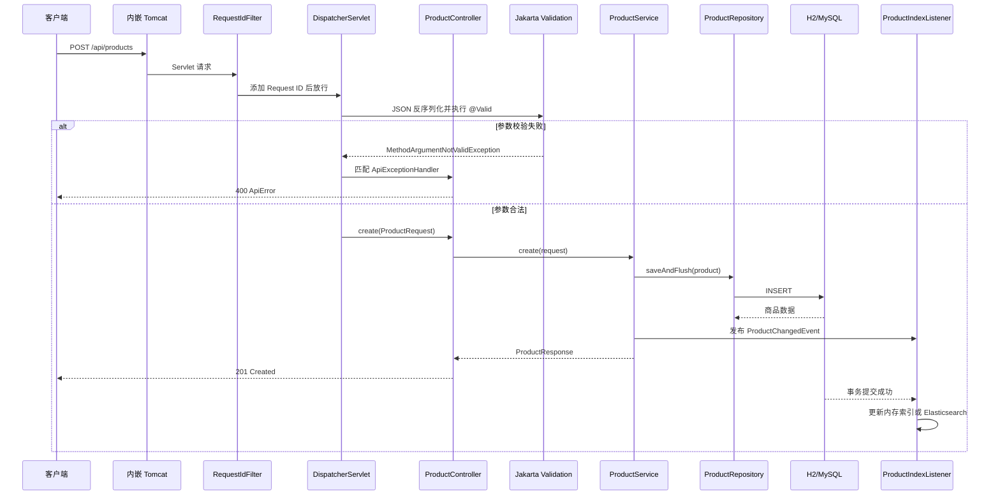

# 阅读核心接口后，应该理解 Spring Boot 哪些核心能力

本文结合 `java_exp` 商品接口项目，回答一个核心问题：

> 阅读 Controller、Service、Repository 等核心代码后，应该建立怎样的 Spring Boot 知识体系？

目标不是记住注解名称，而是能够解释一次请求如何被接收、校验、执行、落库、缓存、记录日志并返回响应。

## 一、先给结论

阅读完本项目的核心接口后，至少应该理解以下十项能力：

1. Spring Boot 启动与自动配置
2. Spring IoC 容器与依赖注入
3. Spring MVC 请求处理链
4. 参数校验与全局异常处理
5. JPA 实体映射与 Repository 动态代理
6. Service 分层与声明式事务
7. Spring Cache 缓存抽象
8. 事务事件与数据一致性
9. Profile、配置文件与基础设施切换
10. Filter、AOP、Actuator 与自动化测试

这些能力共同组成了一个可运行、可维护、可测试的后端应用。

## 二、Spring 与 Spring Boot 的边界

Spring Boot 不是另一套独立框架，而是对 Spring 生态的自动装配和工程化封装。

| 能力 | 主要归属 |
|---|---|
| IoC、依赖注入、Bean 生命周期 | Spring Framework |
| Spring MVC、DispatcherServlet | Spring Framework |
| AOP、声明式事务 | Spring Framework |
| JPA Repository | Spring Data JPA |
| 参数校验 | Jakarta Validation |
| Starter、自动配置、内嵌 Tomcat | Spring Boot |
| Profile 和外部化配置 | Spring Framework + Spring Boot |
| Actuator | Spring Boot |

可以概括为：

```text
Spring 提供能力
Spring Boot 根据依赖、配置和约定自动组装这些能力
```

## 三、完整请求链路

以创建商品接口 `POST /api/products` 为例：



学习时应能从图中的任意节点继续向下解释，而不是只会描述 Controller。

## 四、核心能力详解

### 1. Spring Boot 启动与自动配置

项目入口：

- [`JavaExpApplication.java`](../src/main/java/com/example/javaexp/JavaExpApplication.java)
- [`pom.xml`](../pom.xml)

核心代码：

```java
@SpringBootApplication
public class JavaExpApplication {

    public static void main(String[] args) {
        SpringApplication.run(JavaExpApplication.class, args);
    }
}
```

`@SpringBootApplication` 组合了三类能力：

```text
@SpringBootConfiguration
@EnableAutoConfiguration
@ComponentScan
```

它们分别负责：

- 声明应用的主配置类。
- 根据类路径和配置自动创建框架 Bean。
- 扫描 `com.example.javaexp` 及其子包中的业务组件。

`SpringApplication.run()` 的主要过程是：

```text
读取配置和 Profile
→ 判断应用类型
→ 创建 ApplicationContext
→ 解析主配置类
→ 扫描组件并执行自动配置
→ 创建 Bean 并注入依赖
→ 启动内嵌 Tomcat
→ 注册 DispatcherServlet
→ 开始接收 HTTP 请求
```

项目引入了 `spring-boot-starter-web`，所以 Spring Boot 检测到 MVC 和 Tomcat 相关类后，会自动配置：

- Spring MVC
- Jackson
- DispatcherServlet
- 内嵌 Tomcat

需要掌握：

- Starter 是一组经过协调的依赖，不是业务框架。
- 自动配置有条件，不是无条件创建所有 Bean。
- 用户自己提供同类型 Bean 时，部分自动配置会退让。
- Nginx 或 API Gateway 不会替代 Tomcat，它们处在不同层。

### 2. IoC 容器与依赖注入

`ApplicationContext` 可以理解为：

```text
Bean 注册表 + 依赖注入器 + 生命周期管理器
```

项目中的 Bean 包括：

- `ProductController`
- `ProductService`
- `ProductIndexListener`
- `RequestIdFilter`
- `ServiceTimingAspect`
- `ProductSearchGateway` 的当前 Profile 实现

例如：

```java
public ProductController(ProductService productService) {
    this.productService = productService;
}
```

Spring 创建 `ProductController` 时，会从容器中找到 `ProductService` 并传给构造器。

推荐构造器注入的原因：

- 依赖关系明确。
- 字段可以保持 `final`。
- 测试时容易直接构造对象。
- 缺少依赖时应用启动立即失败。
- 避免隐藏依赖和空指针。

需要掌握：

- `@RestController`、`@Service`、`@Component` 都能让类成为 Bean。
- `@Configuration` 和 `@Bean` 用于显式创建 Bean。
- 同一接口有多个实现时，需要通过 Profile、`@Primary` 或 `@Qualifier` 消除歧义。
- 事务、缓存和 AOP 通常依赖 Spring 创建的代理对象。

### 3. Spring MVC 请求处理链

项目入口：

- [`ProductController.java`](../src/main/java/com/example/javaexp/product/api/ProductController.java)
- [`ProductRequest.java`](../src/main/java/com/example/javaexp/product/api/ProductRequest.java)
- [`ProductResponse.java`](../src/main/java/com/example/javaexp/product/api/ProductResponse.java)

一次请求的主链路是：

```text
Tomcat
→ Filter
→ DispatcherServlet
→ HandlerMapping
→ ProductController
→ ProductService
→ 返回值处理器
→ Jackson
→ JSON 响应
```

常见注解的职责：

| 注解 | 作用 |
|---|---|
| `@RestController` | 声明 REST Controller，并将返回值写入响应体 |
| `@RequestMapping` | 声明公共路由前缀 |
| `@GetMapping` | 处理 GET 请求 |
| `@PostMapping` | 处理 POST 请求 |
| `@RequestBody` | 将 JSON 请求体转换成 Java 对象 |
| `@PathVariable` | 读取路径参数 |
| `@RequestParam` | 读取查询参数 |
| `ResponseEntity` | 显式控制状态码、Header 和响应体 |

需要掌握：

- Tomcat 负责接收 HTTP 请求，DispatcherServlet 负责在 Spring MVC 中分发请求。
- Jackson 负责 Java 对象与 JSON 之间的转换。
- Controller 负责 HTTP 协议适配，不应该承载核心业务规则。
- DTO 与 Entity 应分离，避免数据库模型直接成为外部接口契约。

### 4. 参数校验与全局异常处理

项目入口：

- [`ProductRequest.java`](../src/main/java/com/example/javaexp/product/api/ProductRequest.java)
- [`ApiExceptionHandler.java`](../src/main/java/com/example/javaexp/product/api/ApiExceptionHandler.java)
- [`ProductNotFoundException.java`](../src/main/java/com/example/javaexp/product/service/ProductNotFoundException.java)
- [`InvalidSearchCriteriaException.java`](../src/main/java/com/example/javaexp/product/service/InvalidSearchCriteriaException.java)

请求体校验：

```java
public ResponseEntity<ProductResponse> create(
        @Valid @RequestBody ProductRequest request)
```

执行顺序：

```text
JSON 反序列化
→ @Valid 校验 ProductRequest
→ 校验成功后才调用 Controller 方法
```

如果 `name` 为空或 `price` 小于 `0.01`，Spring 会抛出 `MethodArgumentNotValidException`，Controller 方法不会执行。

查询参数校验由 Controller 上的 `@Validated` 配合参数约束完成，例如：

```java
@NotBlank
@Size(max = 100)
String keyword
```

`ApiExceptionHandler` 的执行机制：

```text
请求处理过程中抛出异常
→ DispatcherServlet 捕获
→ HandlerExceptionResolver 查找处理器
→ 按异常类型匹配 @ExceptionHandler
→ 执行 ApiExceptionHandler 对应方法
→ ResponseEntity 决定状态码
→ Jackson 将 ApiError 转成 JSON
```

项目中的映射关系：

| 异常 | HTTP 状态 |
|---|---|
| `MethodArgumentNotValidException` | 400 |
| `ConstraintViolationException` | 400 |
| `InvalidSearchCriteriaException` | 400 |
| `ProductNotFoundException` | 404 |

需要掌握：

- 参数格式错误和业务规则错误是两类不同问题。
- 全局异常处理能避免 Controller 中重复编写 `try/catch`。
- 未显式处理的异常最终会进入 Spring Boot 默认的 `/error` 处理链。
- 生产接口不应将数据库错误、堆栈或敏感信息直接返回给客户端。

### 5. JPA 实体与 Repository 动态代理

项目入口：

- [`Product.java`](../src/main/java/com/example/javaexp/product/model/Product.java)
- [`ProductRepository.java`](../src/main/java/com/example/javaexp/product/repository/ProductRepository.java)

`Product` 通过 JPA 注解映射数据库表，Repository 只需要声明接口：

```java
public interface ProductRepository extends JpaRepository<Product, Long> {
}
```

项目没有手写 `ProductRepositoryImpl`，因为 Spring Data JPA 会在启动时：

```text
扫描 Repository 接口
→ 读取接口泛型和方法定义
→ 创建动态代理对象
→ 将代理对象注册为 Bean
```

Repository 中包含三类查询：

1. 继承方法，例如 `findById()`、`findAll()`、`save()`。
2. 派生查询，例如 `findByCategoryIgnoreCase()`。
3. `@Query` 查询，例如原生 SQL `findByMinimumPrice()`。

需要掌握：

- Repository 是数据访问边界，不是业务层。
- 派生查询通过方法名生成查询。
- `Pageable` 同时表达分页与排序。
- 原生 SQL 与具体数据库耦合更强，应在确有必要时使用。
- `saveAndFlush()` 会立即把变更刷新到数据库，但事务可能仍未提交。

### 6. Service 分层与声明式事务

项目入口：

- [`ProductService.java`](../src/main/java/com/example/javaexp/product/service/ProductService.java)

Service 的职责是：

- 编排业务规则。
- 控制事务边界。
- 调用 Repository、缓存和搜索能力。
- 将 Entity 转换成对外 DTO。

项目中的写操作使用：

```java
@Transactional
```

查询使用：

```java
@Transactional(readOnly = true)
```

事务通过代理实现：

```text
Controller 调用 ProductService 代理
→ 代理开启事务
→ 调用真实 Service 方法
→ 正常返回时提交
→ 抛出符合规则的异常时回滚
```

需要掌握：

- 事务通常放在 Service，而不是 Controller 或 Repository。
- 默认情况下，未捕获的 `RuntimeException` 会触发回滚。
- `readOnly = true` 表达只读意图，并允许框架和数据库进行优化。
- 同一个类内部通过 `this` 调用另一个 `@Transactional` 方法，可能绕过代理。
- 数据库事务不能自动覆盖 Redis、Elasticsearch 或远程 RPC。

### 7. Spring Cache 缓存抽象

项目入口：

- [`ProductService.java`](../src/main/java/com/example/javaexp/product/service/ProductService.java)
- [`CacheConfig.java`](../src/main/java/com/example/javaexp/config/CacheConfig.java)

核心注解：

| 注解 | 作用 |
|---|---|
| `@Cacheable` | 命中缓存时直接返回，未命中才执行方法 |
| `@CachePut` | 始终执行方法，并使用返回值更新缓存 |
| `@CacheEvict` | 删除指定缓存 |

本项目的策略是：

```text
创建商品：写数据库后更新缓存
查询商品：优先读取缓存
更新商品：写数据库后覆盖缓存
删除商品：删除数据库记录并清理缓存
```

默认 Profile 使用 JVM 内存缓存，`infra` Profile 使用 Redis，并配置十分钟 TTL。

需要掌握：

- Spring Cache 是抽象，Redis 只是其中一种实现。
- 数据库是商品真相源，缓存只是查询加速层。
- 缓存 Key、TTL、序列化方式和失效策略都需要明确设计。
- 缓存注解通常也通过代理执行，类内部自调用可能绕过缓存代理。
- 数据库更新成功但缓存更新失败时，需要考虑一致性和补偿。

### 8. 事务事件与数据一致性

项目入口：

- [`ProductChangedEvent.java`](../src/main/java/com/example/javaexp/product/service/ProductChangedEvent.java)
- [`ProductIndexListener.java`](../src/main/java/com/example/javaexp/product/service/ProductIndexListener.java)

Service 保存商品后发布事件：

```java
eventPublisher.publishEvent(new ProductChangedEvent(type, product));
```

监听器使用：

```java
@TransactionalEventListener(phase = TransactionPhase.AFTER_COMMIT)
```

含义是：

```text
数据库事务提交成功
→ 执行 ProductIndexListener
→ 更新内存索引或 Elasticsearch
```

如果数据库事务回滚，监听器不会更新搜索索引，从而避免“数据库没有商品，但搜索中已经存在”的错误。

需要掌握：

- `AFTER_COMMIT` 解决了执行顺序问题，但没有形成数据库与 Elasticsearch 的原子事务。
- 提交后更新索引失败时，数据库不会回滚。
- 真实生产系统通常还需要重试、Outbox、消息队列或定时对账。
- `ApplicationEventPublisher` 默认是进程内事件，不等同于消息队列。

### 9. Profile 与外部化配置

项目入口：

- [`application.properties`](../src/main/resources/application.properties)
- [`application-infra.properties`](../src/main/resources/application-infra.properties)
- [`ProductSearchGateway.java`](../src/main/java/com/example/javaexp/product/search/ProductSearchGateway.java)
- [`InMemoryProductSearchGateway.java`](../src/main/java/com/example/javaexp/product/search/InMemoryProductSearchGateway.java)
- [`ElasticsearchProductSearchGateway.java`](../src/main/java/com/example/javaexp/product/search/ElasticsearchProductSearchGateway.java)

项目提供两套运行环境：

| 模式 | 数据库 | 缓存 | 搜索 |
|---|---|---|---|
| 默认模式 | H2 | JVM 内存 | JVM 内存索引 |
| `infra` Profile | MySQL | Redis | Elasticsearch |

搜索能力通过接口隔离：

```text
ProductService
→ ProductSearchGateway
   ├── @Profile("!infra") InMemoryProductSearchGateway
   └── @Profile("infra") ElasticsearchProductSearchGateway
```

Service 只依赖接口，运行环境决定注入哪个实现。

需要掌握：

- Profile 控制哪些配置和 Bean 生效。
- `${ENV_NAME:defaultValue}` 支持环境变量覆盖。
- 密码等敏感配置不能提交到仓库。
- 开发环境和生产环境可以使用不同基础设施，但业务接口应保持一致。
- 配置错误应尽量在启动阶段暴露，而不是等到请求到达后才失败。

### 10. Filter、AOP、Actuator 与测试

项目入口：

- [`RequestIdFilter.java`](../src/main/java/com/example/javaexp/config/RequestIdFilter.java)
- [`ServiceTimingAspect.java`](../src/main/java/com/example/javaexp/config/ServiceTimingAspect.java)
- [`ProductControllerTest.java`](../src/test/java/com/example/javaexp/product/ProductControllerTest.java)
- [`CacheConfigTest.java`](../src/test/java/com/example/javaexp/config/CacheConfigTest.java)

#### Filter

`RequestIdFilter` 位于 DispatcherServlet 之前，用于：

- 接收或生成 `X-Request-Id`。
- 将 Request ID 放入 MDC。
- 在响应中返回相同的 Request ID。
- 请求结束后清理 MDC，避免线程复用导致日志串号。

#### AOP

`ServiceTimingAspect` 拦截 `ProductService` 公共方法，记录方法耗时。

它体现了横切关注点：

```text
业务方法只处理业务
日志、耗时、事务、缓存由代理统一处理
```

#### Actuator

项目暴露：

- `/actuator/health`
- `/actuator/info`
- `/actuator/metrics`
- `/actuator/caches`

生产环境通常使用健康检查判断实例是否可以接收流量。

#### 测试

`ProductControllerTest` 使用：

```java
@SpringBootTest
@AutoConfigureMockMvc
```

它会启动 Spring 测试上下文，并通过 MockMvc 验证：

- 路由
- JSON 序列化
- 参数校验
- 异常处理
- 数据库写入
- 分页和搜索
- 缓存更新
- Request ID

`CacheConfigTest` 则聚焦验证 Redis 序列化配置。

需要掌握：

- Filter 处理 Servlet 请求级别的横切逻辑。
- AOP 处理 Spring Bean 方法级别的横切逻辑。
- Actuator 提供运行状态，不等同于完整监控系统。
- 测试应验证可观察行为，而不是只验证某个方法被调用。

## 五、看到一个接口时应该怎样分析

以后阅读 Spring Boot 接口，可以按以下顺序提问。

### 1. HTTP 契约

- 请求方法和 URL 是什么？
- 参数来自路径、查询字符串还是请求体？
- 成功状态码是什么？
- 失败时返回哪些状态码？

### 2. 参数转换与校验

- JSON 转换成哪个 DTO？
- 有哪些 `@NotBlank`、`@Size`、`@DecimalMin` 约束？
- 校验失败时 Controller 是否会执行？
- 异常最终由谁转换成响应？

### 3. Bean 与调用关系

- Controller 注入了哪个 Service？
- Service 又依赖哪些 Repository 或 Gateway？
- 当前注入的是哪个 Profile 的实现？

### 4. 数据与事务

- 哪个对象是 Entity？
- SQL 由派生查询、JPQL 还是原生 SQL 生成？
- 事务从哪里开始，在哪里提交？
- 异常发生时是否回滚？

### 5. 一致性

- 是否读写缓存？
- 缓存什么时候更新或删除？
- 是否更新搜索索引？
- 数据库成功但 Redis 或 Elasticsearch 失败怎么办？

### 6. 工程保障

- 是否有请求追踪信息？
- 是否记录耗时和错误日志？
- 是否有健康检查？
- 是否有测试覆盖成功和失败路径？

## 六、自测清单

完成本项目学习后，应该能够独立回答：

- [ ] `@SpringBootApplication` 包含哪三类核心能力？
- [ ] `SpringApplication.run()` 启动过程中创建了什么？
- [ ] 为什么引入 `spring-boot-starter-web` 后可以直接启动 Tomcat？
- [ ] ApplicationContext 和 Bean 分别是什么？
- [ ] Spring 如何把 `ProductService` 注入 `ProductController`？
- [ ] HTTP 请求如何从 Tomcat 到达 `ProductController`？
- [ ] `@Valid` 与 `@Validated` 分别校验什么？
- [ ] `ApiExceptionHandler` 为什么不需要手动调用？
- [ ] 为什么 Repository 接口没有实现类也可以运行？
- [ ] `@Transactional` 为什么通常写在 Service？
- [ ] `@Cacheable`、`@CachePut`、`@CacheEvict` 有什么区别？
- [ ] 为什么搜索索引要在事务提交后更新？
- [ ] `ApplicationEventPublisher` 为什么不能替代消息队列？
- [ ] 默认模式与 `infra` Profile 分别注入哪些实现？
- [ ] Filter、AOP 和 Controller Advice 分别适合解决什么问题？
- [ ] MockMvc 测试覆盖了请求链中的哪些组件？

如果只能说出注解含义，还不算真正掌握。能够把这些问题串成一条完整执行链，才说明理解了 Spring Boot 项目。

## 七、面试中的简洁回答

可以用下面这段话回答“阅读核心接口后，你理解了哪些 Spring Boot 能力”：

> 我主要理解了 Spring Boot 如何通过 Starter 和自动配置启动 Spring 容器、内嵌 Tomcat 与 Spring MVC；业务 Bean 如何通过组件扫描和构造器注入完成装配；HTTP 请求如何经过 Filter、DispatcherServlet、Controller、Validation、Service 和 Repository；JPA 如何通过动态代理生成数据访问实现；事务、缓存和 AOP 如何通过代理生效；异常如何由 Controller Advice 统一转换成 HTTP 响应。项目还通过 Profile 切换 H2/MySQL、内存缓存/Redis、内存搜索/Elasticsearch，并使用事务提交后事件维护搜索索引，使用 Actuator 和 MockMvc 完成运行观测与链路测试。

## 八、推荐学习顺序

建议按以下顺序继续阅读：

1. `JavaExpApplication.java` 和 `pom.xml`
2. `ProductController.java`
3. `ProductRequest.java` 和 `ApiExceptionHandler.java`
4. `ProductService.java`
5. `Product.java` 和 `ProductRepository.java`
6. `CacheConfig.java`
7. `ProductChangedEvent.java` 和 `ProductIndexListener.java`
8. 两个 `ProductSearchGateway` 实现
9. `RequestIdFilter.java` 和 `ServiceTimingAspect.java`
10. `ProductControllerTest.java`

这条顺序对应：

```text
启动装配
→ Web 请求
→ 校验异常
→ 业务事务
→ 数据访问
→ 缓存一致性
→ 事件与搜索
→ 工程保障
→ 自动化验证
```
